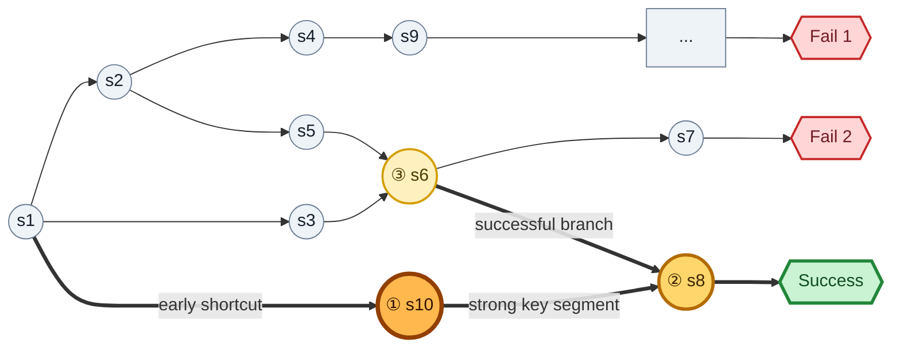

# 技术路线：BottleneckFlow

> 暂定名称：**BottleneckFlow: Key-State Discovery and Milestone-to-Milestone Credit Flow**
>
> 中文暂定名：**基于关键节点和关键路径段的历史步骤信用分配**
>
> 状态：Idea 和技术方案仍在设计中。本文只统一当前主线，不代表方法已经被实验验证。

## 1. 研究边界与 Storyline

### 1.1 研究问题

Agent 做一个长任务时，通常要连续执行很多步，最后才知道成功还是失败。

普通 GRPO 会把最终结果分给整条轨迹：成功轨迹里的每一步一起奖励，失败轨迹里的每一步一起惩罚。但真实情况不是这样：

- 成功轨迹里也可能有绕路、查看和重复操作；
- 失败轨迹前半段也可能做对了，只是在后面走错；
- 有些步骤很早就把任务带入了一个“后面很容易成功”的区域；
- 有些步骤只是临近终点，不能解释前面哪些动作真正起了作用。

我们要回答两个连续的问题：

1. **哪些状态是关键节点？**
2. **为了到达这些关键节点，前面的哪些 step 真正有贡献？**

给定同一个 task 下的一组 rollout：

$$
\mathcal T_x=\{\tau_i\}_{i=1}^{N},\qquad
\tau_i=(s_{i,1},a_{i,1},\ldots,s_{i,T_i+1},R_i),
$$

方法输出每条轨迹中每个 action turn 的 advantage：

$$
(\mathcal T_x,\{R_i\})
\longrightarrow
\{A_{i,1},A_{i,2},\ldots,A_{i,T_i}\}.
$$

### 1.2 核心矛盾 / Motivation

现有工作通常直接评价每个 action：比较相同状态下的动作、计算到终点的图距离、用规则标注 milestone、统计成功/失败经验，或者训练额外的 step reward model。但在给 step 打分以前，还有一个更基础的问题：

> 长轨迹中的什么进展真正值得获得 credit？

我们先找出能让 Agent 尽早进入可靠成功区域的关键节点，再判断哪些历史 step 促成了这些节点。

一个节点是否关键，先看四个直观问题：


| 直觉                   | 数学含义            |
| ---------------------- | ------------------- |
| 成功轨迹经常经过这个点 | 必要性 / 成功覆盖率 |
| 到了这个点通常就能成功 | 充分性 / 后验成功率 |
| 越早到达越好           | 早期承诺能力        |
| 经过该点的成功轨迹较短 | 路径效率 / 剩余成本 |

这四个问题不能互相替代。

- 一个点可能所有成功轨迹都会经过，但它总是在最后才出现；
- 一个点可能不是所有成功轨迹都经过，但只要很早到达，后面通常很快成功；
- 一个点可能出现得很早，但成功和失败轨迹都会经过，因此没有区分度；
- 一个点可能离终点很近，但到达它之前已经绕了很久。

找到关键节点后还有第二个矛盾：只奖励“进入关键点的最后一步”太局部，把 credit 平均撒给全部历史又太粗。我们真正想加强的是：

```text
普通状态 → 关键点 → 关键路径段 → 下一个关键点 → success
```

尤其是两个关键节点之间短而稳定的有效路径。

### 1.3 核心 Claim / Storyline

以下都是等待实验验证的假设，不是已有结论。

#### Claim 1：Success-contrastive key-state discovery

关键状态不应该只由“离终点多近”决定，而应该综合考虑：

- 它覆盖了多少成功轨迹；
- 到达后成功率提高了多少；
- 它是否足够早；
- 从它到成功的剩余路径是否高效；
- 这些现象是否有足够样本支持，而不是一次幸运成功。

因此，一个很早出现的成功捷径，可能比一个很晚才出现的成功汇合点更重要。关键节点来自成功与失败 rollout 形成的经验图，不依赖预先编写的 milestone 规则。

#### Claim 2：Per-key-state ancestor responsibility

关键节点的 credit 不应该只给进入它的最后一步，也不应该无差别给所有历史步骤或只按时间距离衰减。历史 edge 获得多少 credit，应取决于：

- 它是否稳定出现在通往该关键节点的成功路径上；
- 它在失败轨迹中是否同样常见；
- 它是否处于两个关键节点之间；
- 在相同状态下，该 action 是否比其他 action 更容易走向成功。

#### Claim 3：Key-state-wise conservative credit flow

每个关键节点只提供固定总量的 credit。先在不同来路之间分，再在每条路径段内部给具体 step 分账：

$$
\sum_uM(u,v)=I(v),
$$

$$
\sum_{e\in\operatorname{Segment}(u,v)}C(e\mid u,v)=M(u,v).
$$

这样既能保留失败轨迹中已经取得的有效进展，也能避免无差别强化成功轨迹中的绕路和冗余行为；同时不会因为节点来路多、路径长或被重复采样，就凭空制造更多 reward。

#### 完整 Storyline

可以把论文主线收敛成：

> 现有 step-level credit assignment 通常直接评价每一个 action，却没有先问“长轨迹中什么进展真正值得获得 credit”。我们先从多条 rollout 构成的经验图中自动发现控制成功的关键节点，再以这些节点为锚，将有限的节点 credit 按路径责任分配给历史祖先步骤。这样既能保留失败轨迹中已经取得的有效进展，也能避免无差别强化成功轨迹中的绕路和冗余行为。

### 1.4 方法主线

```text
同一 task 采样多条 rollout
        ↓
合并成 rollout graph
        ↓
用四个问题找关键节点
        ↓
按关键节点把每条轨迹切成路径段
        ↓
把关键节点的 credit 分给关键路径段和其中的 step
        ↓
用 step credit 调整 GRPO advantage
```

具体流程：

1. 对同一个 task 采样一组成功、失败或截断的轨迹；
2. 把相同状态和 transition 合并成 rollout graph；
3. 用成功覆盖、到达后成功率、出现位置和剩余路径长度给节点打分；
4. 选出少量关键节点，去掉起点、终点、普通公共前缀和连续重复节点；
5. 在每条轨迹里按照 first visit 排列实际经过的关键节点；
6. 把轨迹切成 `起点 → 关键点 → 关键点 → 终点` 的路径段；
7. 关键节点先把固定 credit 分给不同来路，再由路径段分给其中的 step；
8. 用结构 credit 调整 GRPO 的 turn-level advantage，但不改变整条轨迹原本的成功或失败方向。

### 1.5 与相邻工作的边界


| 工作                                                                                                              | 方案概述                                                                  | 与我们的边界                                                                       |
| ----------------------------------------------------------------------------------------------------------------- | ------------------------------------------------------------------------- | ---------------------------------------------------------------------------------- |
| [GraphGPO](https://proceedings.mlr.press/v306/cheng26e.html)                                                      | 合并 rollout graph，用状态到成功终点的最短距离给 transition 分配 credit   | 图只用于计算 goal distance；不识别少量关键瓶颈节点，也不把节点 credit 分给祖先路径 |
| [BEACON](https://proceedings.mlr.press/v306/wang26jm.html)                                                        | 用任务规则识别 milestone，在 segment 内按时间距离衰减 reward              | 我们从跨轨迹图自动识别关键节点；关键 step 按路径责任分配，不按时间距离衰减         |
| [GiGPO](https://papers.nips.cc/paper_files/paper/2025/file/420c9f777c0b4f78d515e53cf74d58b2-Paper-Conference.pdf) | 将相同状态组成 anchor group，比较不同 action 的后续 return                | 相同状态只是局部比较锚点，不代表该状态关键；没有节点排序和祖先 credit flow         |
| [HGPO](https://openreview.net/pdf?id=T8Dev99qnz)                                                                  | 在相同状态分组上进一步按历史上下文建立层次化子组                          | 历史是当前 action 比较的条件，不是被重新分配 credit 的对象                         |
|                                                                                                                   |                                                                           |                                                                                    |
| [iStar](https://openreview.net/pdf?id=ooROvpmxMV)                                                                 | 用轨迹偏好训练隐式 PRM，产生 step reward                                  | 依赖额外 PRM；step reward 不显式表示瓶颈节点、路径结构和祖先责任                   |
| **BottleneckFlow**                                                                                                | 先从经验图发现成功关键节点，再把节点 credit 分给有责任的祖先 segment/step | 研究“什么进展重要”以及“哪些历史步骤促成了这些进展”                             |

我们不把下面任何一个单项当作 novelty：

- 把同任务 rollout 合并成图；
- 用成功率或访问频率找关键状态；
- 用 goal distance 或 value difference 给 step 打分；
- 在同一状态比较不同 action；
- 在 hierarchical RL 中发现 bottleneck/subgoal。

当前真正需要验证的是这个组合：

> 跨轨迹关键节点自动发现 + per-key-state ancestor responsibility + conservative segment flow。

### 1.6 预期贡献

如果实验成立，预期贡献可以概括成三点：

1. 从 Agent 自己产生的成功/失败 rollout graph 中自动发现 success-relevant key state，不依赖环境 milestone 规则；
2. 提出 per-key-state ancestor credit flow，根据路径责任给历史 segment 和 step 分账，而不是只奖励最后一步或按时间距离衰减；
3. 在不引入额外 PRM、反事实 rollout 和过程标注的情况下，统一处理失败轨迹中的有效进展和成功轨迹中的冗余行为。

## 2. 暂定技术方案

这一节保留多种候选方案。001 会先选一套简单、保守、能解释的版本跑起来，其他方案作为消融或后续增强。

### 2.1 Rollout graph 和统计口径

对一个 task 的 rollout group 构图：

$$
G_x=(V_x,E_x),\qquad e=(v,a,v').
$$

节点和边记录：

- 出现在哪些成功、失败或截断轨迹；
- first visit 位置；
- 从该点到终点的剩余步数；
- action、环境变化和最终 reward；
- 同状态下出现过的其他 action 和后续结果。

统计使用 trajectory-level coverage。一条轨迹反复经过同一个节点十次，仍然只算一条支持证据，避免循环刷频次。

节点 key 必须包含真正影响后续决策的信息。observation 一样但 inventory、任务进度、剩余步数或隐藏环境状态不同，不能盲目合并。

### 2.2 关键节点的四个基础指标

记轨迹结果为 $Y_i\in\{0,1\}$，长度为 $L_i$，第一次访问节点 $v$ 的位置为 $T_i(v)$。

#### 成功覆盖率

$$
N(v)=P(v\in\tau\mid Y=1)
=\frac{\sum_iY_i\mathbf 1[v\in\tau_i]}{\sum_iY_i}.
$$

它表示成功轨迹中有多大比例经过该点。

#### 到达后的成功率

使用 Beta/Laplace 平滑，避免一个只出现一次的幸运节点得到虚假的 100%：

$$
S(v)
=\frac{N^+(v)+\alpha}{N^+(v)+N^-(v)+2\alpha}.
$$

再和当前 task 的基础成功率比较：

$$
\operatorname{Lift}(v)
=\operatorname{logit}S(v)-\operatorname{logit}P(Y=1).
$$

#### 早期性

$$
E(v)
=\frac{1}{N^+(v)}
\sum_{i:Y_i=1,v\in\tau_i}
\left(1-\frac{T_i(v)}{L_i}\right).
$$

#### 剩余路径效率

$$
Q(v)
=\frac{1}{N^+(v)}
\sum_{i:Y_i=1,v\in\tau_i}
\exp[-\lambda_d(L_i-T_i(v))].
$$

早期性和剩余路径效率不是一回事。一个点可以出现得早，但后面仍然绕很久。

### 2.3 关键节点打分：四种方案

#### 方案 A：四项加权综合

直接把四项组合成一个可排序分数：

$$
I_A(v)
=q(v)
N(v)^{w_N}
\widetilde S(v)^{w_S}
E(v)^{w_E}
Q(v)^{w_Q},
$$

其中：

$$
\widetilde S(v)=\sigma(\operatorname{Lift}(v)),\qquad
q(v)=\frac{N^+(v)+N^-(v)}{N^+(v)+N^-(v)+c}.
$$

优点是简单、连续、容易排序；缺点是权重比较人工。可以从下面的偏好开始：

$$
w_N=0.5,\qquad w_S=1.0,\qquad w_E=1.0,\qquad w_Q=0.5.
$$

这套权重更看重“到了以后容易成功”和“是否尽早进入成功区域”。

#### 方案 B：先 gate，再排序

先要求节点满足：

- 不是起点或 terminal；
- 成功支持数不少于 $n_{\min}$；
- $N(v)\ge\tau_N$；
- 成功率置信下界高于 task 基础成功率；
- 不是连续重复或几乎等价节点。

通过 gate 后，再用：

$$
I_B(v)
=\operatorname{LCB}[S(v)]
N(v)^{w_N}E(v)^{w_E}Q(v)^{w_Q}
$$

排序。

优点是小样本幸运节点很难进入候选，规则也容易解释。**这是 001 当前最推荐的关键节点方案。**

#### 方案 C：Pareto frontier

不急着把四项压成一个数，而是保留：

$$
z(v)=(N(v),S(v),E(v),Q(v)).
$$

如果节点 $u$ 四项都不差于 $v$，并且至少一项更好，就认为 $u$ 支配 $v$。先删除被支配节点，再从 Pareto frontier 里选 top-$K$。

它可以同时保留两类点：

- 覆盖率高、但出现较晚的成功汇合点；
- 覆盖率稍低、但很早出现的成功捷径。

缺点是最后仍需要稳定的 top-$K$ 规则。

#### 方案 D：反事实必要性

理想情况是直接问：如果禁止经过这个节点，成功率下降多少？

$$
I_D(v)
=P(Y=1)-P(Y=1\mid do(\operatorname{avoid}v)).
$$

它最接近因果贡献，但需要额外分支 rollout、可恢复环境或可靠 world model。主实验不直接使用，先作为小规模 oracle，检验 A/B/C 的排序是否靠谱。

### 2.4 轨迹切分

关键节点的全局重要性排序，不等于它们在某条轨迹中的时间顺序。按照 first visit 排列实际经过的关键点：

```text
τA: start → s10 → s8 → success
τB: start → s6  → s8 → success
τC: start → s6  → s7 → fail
```

切成：

```text
τA: [start, s10] | [s10, s8] | [s8, success]
τB: [start, s6]  | [s6, s8]  | [s8, success]
τC: [start, s6]  | [s6, failure]
```

只使用真实观察到的 first-hit segment，不枚举图中所有理论路径。

### 2.5 关键路径分配：四种方案

#### 方案 A：成功祖先频率

对目标关键点 $v$，统计 edge $e$ 在多少条成功 first-hit 前缀中出现，并扣除失败背景：

$$
\rho_A(e\rightarrow v)
=P(e\prec v\mid v,Y=1)
-\eta P(e\in\tau\mid Y=0).
$$

然后把 $I(v)$ 在合格祖先 edge 之间归一化分配。

优点是简单、无需额外模型；缺点是容易把长公共前缀也当作贡献者。它适合作为 Ancestor-flow 基线。

#### 方案 B：同状态 action 对比

如果多条轨迹在相同状态选择不同 action，比较它们的后续结果：

$$
\rho_B(s,a)
=P(Y=1\mid s,a)-P(Y=1\mid s).
$$

例如：

```text
s6 → s8 → success
s6 → s7 → fail
```

它能清楚区分局部分叉，但要求同状态有足够的 action 重复，且无法单独解释很早的动作如何影响很晚的关键点。

#### 方案 C：Milestone-to-milestone segment flow

先给连接两个关键节点的 segment 打分：

$$
H(u,v)
=\operatorname{Coverage}(u\rightarrow v)
\left(1+\kappa\sqrt{I(u)I(v)}\right)
\exp[-\xi\ell(u,v)].
$$

其中 $\ell(u,v)$ 是平均 segment 长度。再把目标节点 $v$ 的固定 credit 分给不同来路：

$$
M(u,v)
=I(v)\frac{H(u,v)}{\sum_{u'}H(u',v)},
\qquad
\sum_uM(u,v)=I(v).
$$

segment 内部再按成功支持、失败背景和 local action advantage 分账：

$$
\rho_C(e;u,v)
=q_{e,u,v}
\left[
P(e\in\tau[u:v]\mid Y=1,u\prec v)
-\eta P(e\in\tau\mid Y=0)
+\zeta\rho_B(s,a)
\right]_+,
$$

$$
W(e\mid u,v)
=\frac{\exp(\rho_C(e;u,v)/\tau)}
{\sum_{e'\in\operatorname{Segment}(u,v)}\exp(\rho_C(e';u,v)/\tau)},
$$

$$
C(e\mid u,v)=M(u,v)W(e\mid u,v).
$$

它能重点增强 `s10 → s8` 这类连接两个高价值节点、短而稳定的路径。**这是 001 当前最推荐的关键路径方案。**

#### 方案 D：反事实路径贡献

从同一状态替换 action 或避开某条 segment，直接观察到达关键点或最终成功的概率下降：

$$
\rho_D(e\rightarrow v)
=P(v\text{ reached}\mid do(e))
-P(v\text{ reached}\mid do(e')).
$$

也可以直接看最终成功：

$$
\rho_D(e\rightarrow Y)
=P(Y=1\mid do(e))-P(Y=1\mid do(e')).
$$

它最接近真实 action contribution，但会增加环境交互预算。先作为合成图或少量可恢复任务上的 oracle，不进入 matched-budget 主实验。

### 2.6 001 暂定组合

首轮实现暂定使用：

- **节点方案 B**：先做支持度和置信度 gate，再综合四项排序；
- **路径方案 C**：milestone-to-milestone segment flow；
- 在 segment 内吸收方案 B 的 local action advantage；
- 节点方案 D 和路径方案 D 只作为小规模反事实 oracle。

这套组合的原因是：它不需要额外模型或额外主实验 rollout，能表达 `s10 > s8 > s6` 和 `s10 → s8` 强化，同时保留固定 credit mass。

### 2.7 接入 GRPO

先计算普通 trajectory-level GRPO advantage：

$$
A_i^{\mathrm{traj}}
=\frac{R_i-\mu_x}{\sigma_x+\epsilon}.
$$

结构 credit 只调整一条轨迹内部的 turn weight：

$$
A_{i,t}=A_i^{\mathrm{traj}}w_{i,t}.
$$

要求：

- 成功轨迹中，高 credit step 获得更大的正权重；
- 失败轨迹中，被成功结构支持的 step 只减轻惩罚，不翻成正奖励；
- $w_{i,t}$ 限制在例如 $[0.5,2.0]$；
- 每条轨迹的 action-token 总预算保持不变；
- 当 $A_i^{\mathrm{traj}}=0$ 时，不靠图结构制造训练方向。

可用形式：

$$
u_{i,t}
=\exp\left(
\operatorname{sign}(A_i^{\mathrm{traj}})
\lambda_c z(C_{i,t})
\right),
$$

再做边界投影和 token-budget normalization，得到 $w_{i,t}$。

### 2.8 Fallback 和风险控制

以下情况整个 task group 回退普通 GRPO：

- group 没有成功与失败差异；
- 成功轨迹太少；
- 没有通过 gate 的关键节点；
- 没有实际观察到的关键路径段；
- state/edge 匹配覆盖不足；
- credit 守恒、shape、mask 或有限值检查失败。

还需要防止：小样本幸运节点、普通公共前缀、循环刷访问次数、状态错误合并、重复路径制造额外 credit，以及 behavior-policy 相关性被误写成因果贡献。

## 3. 全流程示例

下面把多条 rollout 合并成一个图。红色分支最后失败，绿色分支最后成功。它只用来说明结构，不代表图中的概率已经由真实实验测出。



### 3.1 希望得到 `s10 > s8 > s6`

**s10：早期成功入口。** 到达后通常能成功，出现得早，而且到成功的路线短。它未必覆盖所有成功轨迹，但很像可靠的早期捷径，因此当前设计允许它排第一。

**s8：成功汇合点。** 成功轨迹经常或全部经过它，到达后通常能成功；但它出现得晚，更像成功路径最后的汇合处，因此排在 s10 后面。

**s6：有希望，但不充分。** 从 s6 可以走向 s8 并成功，也可以走向 s7 并失败。到达 s6 没有到达 s10、s8 那么可靠，因此排第三。

这个排序不是由拓扑唯一决定的。如果更强调“所有成功都必须经过”，s8 可能高于 s10。当前排序表达的是“尽早进入可靠且高效的成功区域”这一设计偏好，后续要通过消融验证。

### 3.2 哪些 step 应该加强

成功轨迹：

```text
s1 → s10 → s8 → success
```

切成：

```text
[s1, s10] | [s10, s8] | [s8, success]
```

- `[s1, s10]` 分享 s10 的节点 credit；
- `[s10, s8]` 连接两个高重要性节点，而且短而稳定，应得到较强 segment credit；
- `[s8, success]` 仍有正 credit，但不能因为临近终点就吃掉全部信用。

在分叉点：

```text
s6 → s8 → success
s6 → s7 → fail
```

同状态 action 对比让 `s6 → s8` 优于 `s6 → s7`。local action 负责局部选择，segment flow 负责更长距离的历史贡献。

### 3.3 这个例子如何走完整个算法

1. 多条 rollout 合并后，统计每个节点的 $N,S,E,Q$；
2. 节点方案 B 过滤低支持节点，并得到 `s10 > s8 > s6`；
3. 每条轨迹按 first-hit 关键点切段；
4. 对 s8 的不同来路比较，`s10 → s8` 因为两端重要、路径短而获得较高 segment mass；
5. segment 内根据成功支持、失败背景和同状态 action advantage 给 step 分账；
6. 所有 edge credit 映射回原始 turn；
7. 在不改变轨迹 advantage 正负号和总预算的前提下，重加权 GRPO loss。

## 4. 实验结果

### 4.1 基本设定

#### 4.1.1 Baseline


| Baseline                                                                                                          | 会议 / 时间     | 方案概述                                  | 与我们的边界                                                     |
| ----------------------------------------------------------------------------------------------------------------- | --------------- | ----------------------------------------- | ---------------------------------------------------------------- |
| [GraphGPO](https://proceedings.mlr.press/v306/cheng26e.html)                                                      | ICML 2026       | rollout graph + goal-distance step credit | 不识别关键瓶颈，不做节点到祖先路径的 credit flow                 |
| [BEACON](https://proceedings.mlr.press/v306/wang26jm.html)                                                        | ICML 2026       | 规则 milestone + segment 内时间衰减       | 我们用图自动找关键节点，并按路径责任而非距离衰减分配 step credit |
| [GiGPO](https://papers.nips.cc/paper_files/paper/2025/file/420c9f777c0b4f78d515e53cf74d58b2-Paper-Conference.pdf) | NeurIPS 2025    | 相同状态 action micro advantage           | anchor state 不等于关键节点，不向历史祖先分账                    |
| [HGPO](https://openreview.net/pdf?id=T8Dev99qnz)                                                                  | ICLR 2026       | 历史上下文层次分组与加权 advantage        | 历史用于修正当前 action 比较，不接受节点 credit                  |
| [DEPPO](https://aclanthology.org/2026.emnlp-main.1333/)                                                           | EMNLP 2026 Main | 成功池/失败池对比并缩放 advantage         | 没有关键节点、路径拓扑和祖先责任；无可用公开仓库                 |
| [iStar](https://openreview.net/pdf?id=ooROvpmxMV)                                                                 | ICLR 2026       | 隐式 PRM 产生 step reward                 | 需要额外 PRM，不显式建模关键节点和祖先路径                       |

基础对照另含 **Base**（不做 RL）和 **GRPO**（trajectory-level advantage）。方法消融另含 **Ours-node-only**、**Ours-flow-only** 和 **Ours-full**。

除 credit assignment 外，初始模型、prompt、harness、admissible-action 约束、task pool、rollout 预算、reward、optimizer、评测方式和硬件规模保持一致。

#### 4.1.2 Benchmark 与训练数据


| Benchmark               | 频次 | 使用论文                                    |
| ----------------------- | ---: | ------------------------------------------- |
| WebShop                 |  6/6 | GraphGPO、BEACON、GiGPO、HGPO、DEPPO、iStar |
| ALFWorld                |  5/6 | GraphGPO、BEACON、GiGPO、HGPO、DEPPO        |
| Sokoban / VisualSokoban |  3/6 | GraphGPO、DEPPO、iStar                      |
| ScienceWorld            |  1/6 | BEACON                                      |
| SOTOPIA / SOTOPIA-$\pi$ |  1/6 | iStar                                       |
| Search-augmented QA     |  1/6 | GiGPO                                       |


| 论文     | Benchmark / 数据                                                                                                                |
| -------- | ------------------------------------------------------------------------------------------------------------------------------- |
| GraphGPO | ALFWorld、WebShop、Sokoban                                                                                                      |
| BEACON   | ALFWorld、WebShop、ScienceWorld                                                                                                 |
| GiGPO    | ALFWorld、WebShop、NQ、TriviaQA、PopQA、HotpotQA、2WikiMultihopQA、MuSiQue、Bamboogle；扩展实验含 Sokoban、EZPoints、NumberLine |
| HGPO     | ALFWorld、WebShop                                                                                                               |
| DEPPO    | ALFWorld、WebShop、Sokoban                                                                                                      |
| iStar    | WebShop、VisualSokoban、SOTOPIA-$\pi$/SOTOPIA                                                                                   |

主实验使用 **ALFWorld + WebShop**。ALFWorld 使用标准 train split 在线采样 rollout，在 `valid_seen` 和 `valid_unseen` 评测；WebShop 固定训练 session 与 held-out evaluation session。所有方法共享相同 task IDs、split、rollout budget、最大步数和评测脚本。

#### 4.1.3 基模

主实验统一使用 **Qwen3.5-9B**，探索阶段用2B的，所有 baseline 从同一 checkpoint 开始训练。


| 论文     | 原论文使用的基模                                                          |
| -------- | ------------------------------------------------------------------------- |
| GraphGPO | Qwen2.5-1.5B/7B-Instruct；Qwen2.5-VL-3B-Instruct                          |
| BEACON   | Qwen2.5-1.5B/7B-Instruct                                                  |
| GiGPO    | Qwen2.5-1.5B/3B/7B-Instruct；Qwen2.5-VL-3B-Instruct；Qwen2-VL-2B-Instruct |
| HGPO     | Qwen2.5-1.5B/7B-Instruct                                                  |
| DEPPO    | Qwen2.5-1.5B/7B-Instruct；Qwen2.5-VL-3B；Qwen3-VL-8B                      |
| iStar    | Qwen2.5-1.5B/7B-Instruct；Qwen2.5-VL-7B-Instruct；Llama-3.1-8B-Instruct   |

#### 4.1.4 RL 框架

主实验统一使用 **slime**：Megatron 负责训练，SGLang 负责 rollout，Ray 负责调度。六种 baseline 均接入本项目的同一训练链路，只替换 credit/advantage 计算。


| 论文     | 官方实现框架                              | 开源状态                           |
| -------- | ----------------------------------------- | ---------------------------------- |
| GraphGPO | verl-agent / veRL                         | 已开源                             |
| BEACON   | verl-agent / veRL                         | 已开源                             |
| GiGPO    | verl-agent / veRL                         | 已开源                             |
| HGPO     | verl-agent / veRL                         | 已开源                             |
| DEPPO    | 论文称训练设置与 GiGPO 一致，无法审计实现 | 匿名代码链接已不可访问，视为未开源 |
| iStar    | veRL                                      | 已开源                             |

### 4.2 主实验结果

数值待实验完成后填写。


| Benchmark / Metric                  | Base | GRPO | GiGPO | HGPO | GraphGPO | BEACON | DEPPO-style | iStar | Ours |
| ----------------------------------- | ---: | ---: | ----: | ---: | -------: | -----: | ----------: | ----: | ---: |
| ALFWorld`valid_seen` Success Rate   |      |      |       |      |          |        |             |       |      |
| ALFWorld`valid_unseen` Success Rate |      |      |       |      |          |        |             |       |      |
| WebShop Task Score                  |      |      |       |      |          |        |             |       |      |
| WebShop Success Rate                |      |      |       |      |          |        |             |       |      |
| Sokoban Success Rate                |      |      |       |      |          |        |             |       |      |
| VisualSokoban Success Rate          |      |      |       |      |          |        |             |       |      |

### 4.3 消融实验结果

### 4.4 失败 case 分析

### 4.5 可视化分析

## 5. 待验证/待诊断

暂不展开。等方案实现并拿到第一批离线统计和 smoke 结果后，再根据真实问题补充。
