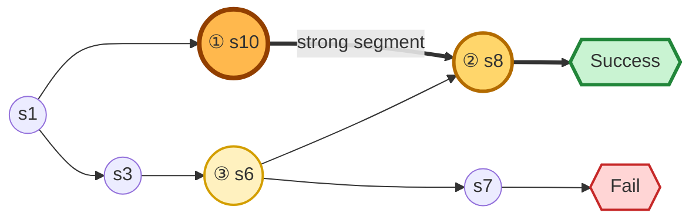

# 001：BottleneckFlow B+C 在 ALFWorld 上的首轮端到端实验

> 对应算法设计：[`../algos/001_algo.md`](../algos/001_algo.md)
>
> 当前状态：实验设计已收敛，尚未完成正式训练。Results 中的数值均待实验后填写。

## 1. Objective：实验目的

本实验只回答一个核心问题：

> 复用 GraphGPO 的 ALFWorld、rollout、经验图和 veRL 训练链路，将其最短路 credit 替换为 BottleneckFlow B+C 后，能否在 ALFWorld `valid_seen` 上得到有竞争力的成功率，并产生符合预期的关键节点和 step credit？

001 中的 BottleneckFlow 固定为：

- **关键节点方案 B**：先做支持度和置信度 gate，再综合成功覆盖率、到达后成功率、早期性和剩余路径效率排序；
- **关键路径方案 C**：按关键节点切分 rollout，执行 milestone-to-milestone segment flow，并在 segment 内结合成功支持、失败背景和 local action advantage 分账；
- **训练接入**：不改变轨迹 reward 的正负，只用结构 credit 重加权 turn-level GRPO advantage。

实验需要回答：

1. B+C 是否能在官方 GraphGPO 主链上稳定训练，并在 `valid_seen` 的六类任务及总体指标上得到有竞争力的结果？
2. B+C 是否真正把高权重分给促成关键状态的 step，并自然压低 invalid/no-op、绕路和失败分支？
3. B+C 的额外图计算和统计成本是否可接受？

001 不做反事实干预或反事实 oracle。先跑出一版完整结果，再根据真实失败模式决定后续诊断。

## 2. Setup：数据、环境、模型、超参数、对照与指标

### 2.1 数据与 benchmark

- 探索阶段默认 benchmark：ALFWorld text environment；
- 训练数据：从官方 `train` split 在线采样 task，由当前 policy 与官方环境交互生成 rollout 和 reward；不使用预先固定的 rollout 数据集；
- veRL DataLoader 需要的 carrier parquet 由项目本地生成最小 placeholder，不下载 Geometry3K；该 parquet 不提供 ALFWorld 任务内容；
- checkpoint 选择、调参和最终报告都只使用 `valid_seen`；001 不跑 `valid_unseen`；
- validation/test rollout 不进入训练 graph、节点统计或 actor update；
- 同一个 GRPO group 必须是同一个 `game.tw-pddl` 的独立 reset，不能把不同 task 混成一组。

`valid_seen` 报告六种任务类型和一个总体值：

| 论文列名 | ALFWorld task type |
| --- | --- |
| Pick | `pick_and_place` |
| Clean | `pick_clean_then_place_in_recep` |
| Cool | `pick_cool_then_place_in_recep` |
| Look | `look_at_obj_in_light` |
| Heat | `pick_heat_then_place_in_recep` |
| Pick2 | `pick_two_obj_and_place` |
| All | 全部 `valid_seen` task 的总体 success rate |

### 2.2 Agent 与 harness

直接复用 GraphGPO 的 ALFWorld prompt 和 harness：

```text
Policy model
  → GraphGPO ALFWorld prompt（最近 2 步 history + location/holding/object state + admissible actions）
  → 输出 `<think>...</think><action>...</action>`
  → GraphGPO harness / ALFWorld
  → environment observation
```

ALFWorld 每一步提供 `admissible_commands`。harness 同时记录协议是否完整、提取动作是否属于 admissible set、环境是否返回 `Nothing happens`，但不做语义修复或 constrained decoding。Invalid/no-op 也作为真实 transition 进入 rollout graph；001 关闭 GraphGPO 官方的 `invalid_action_penalty_coef=0.1`，由 B+C 自己判断这类 step 的价值。

因此 001 不为了工具格式做 SFT。若 viability 检查发现基模几乎没有成功轨迹，说明问题是任务能力冷启动，而不是格式错误；若后续增加任务能力 warm-start，matched baseline 也必须从同一初始 checkpoint 开始。

### 2.3 模型与训练方式

- 基模：`Qwen/Qwen2.5-1.5B-Instruct`，即官方 instruction-tuned Dense checkpoint，不使用 Base 版；
- RL 框架：复用 `verl-agent` 的 GraphGPO recipe，veRL/Ray 负责调度与训练，vLLM 负责 rollout，FSDP 负责分布式 actor；
- 参数更新：001 默认全参数训练，尽量保留 GraphGPO 官方 optimizer、clip、KL 和 batch 口径；
- 精度：BF16；
- attention：对 vLLM/FSDP 分别记录实际 backend，在不改变数值口径的前提下优先使用已验证的 FlashAttention/SDPA；
- loss mask：按 baseline 口径训练完整 assistant response，`<think>` 和 `<action>` token 都进入 loss，prompt/observation token 不进入 loss；
- KL/reference：保留 GraphGPO 官方设定，`use_kl_in_reward=False`，actor KL loss 系数为 `0.01`；
- 硬件：8×A100 80GB，启动时记录 CUDA、驱动、显存和 GPU 拓扑。

### 2.4 三层存储

| 存储层 | 用途 |
| --- | --- |
| 本地 SSD `/localssd` | HF cache、当前 rollout、tokenized batch、临时 checkpoint staging，可重建 |
| CephFS `/cephfs/wenhaozhang` | 代码、manifest、metrics、正式 checkpoint、评测结果、可审计 rollout |
| 存档层 | 最终选定 checkpoint、正式结果、环境清单和报告 |

Pod 恢复不能依赖旧 `/localssd`。checkpoint 先写本地 staging，再完整复制到 CephFS；高频小文件先在本地聚合后批量写入。

模型 checkpoint 从 CephFS 的统一只读路径加载；HF、Triton、FlashInfer、Torch extension 等可重建 cache 放在本地 SSD，正式 checkpoint 和审计产物直接写 CephFS。

### 2.5 首轮超参数

下表是 001 的起始配置，不是已经验证的最优值。

| 类别 | 参数 | 001 起始值 |
| --- | --- | ---: |
| rollout | group size | 16 rollouts / task |
| rollout | tasks / update | 4（profiling 后可调整；后续 matched baseline 使用同一值） |
| rollout | max environment steps | 50；smoke 可用 5–20 |
| rollout | temperature | 0.7 |
| rollout | top-p | 1.0（temperature 仍为 0.7） |
| training | updates | 50 短程主跑，之后再决定是否扩大 |
| training | GRPO optimization epochs | 1 |
| training | clip ratio | 0.2 |
| training | reward KL beta | 0 (`use_kl_in_reward=False`) |
| training | learning rate | $1\times10^{-6}$ |
| training | actor update | full-parameter |
| training | actor KL loss coef | 0.01（沿用 GraphGPO） |
| training | invalid action penalty | 关闭 |
| training | checkpoint | 每 10 updates，`resume_mode=auto`，CephFS 保留最近 2 份 |
| key state | $n_{\min}$ | 2 |
| key state | $\tau_N$ | 0.5 |
| key state | Beta prior | $\operatorname{Beta}(1,1)$ |
| key state | LCB quantile | 0.05 |
| key state | top-$K$ | 3 |
| key state | remaining-path decay $\lambda_d$ | 0.1 |
| key state | $(w_N,w_S,w_E,w_Q)$ | $(0.5,1.0,1.0,0.5)$ |
| dedup | success-support Jaccard | 0.9 |
| dedup | max graph distance | 2 |
| segment | key-to-key bonus $\kappa$ | 1.0 |
| segment | length penalty $\xi$ | 0.2 |
| segment | failure background $\eta$ | 0.5 |
| segment | local advantage weight $\zeta$ | 0.5 |
| segment | flow softmax temperature $\tau$ | 0.5 |
| weighting | credit strength $\lambda_c$ | 0.5 |
| weighting | turn-weight range | $[0.5,2.0]$ |

上表中 B+C 超参是起始值；GraphGPO 训练超参以 `master@20bd331` 的 Qwen2.5-1.5B ALFWorld recipe 为底座。八卡、TP、micro-batch 和 attention backend 只做不改变算法口径的吞吐优化，正式长跑前用单 update profile 确认。

### 2.6 对照设定

001 只运行 BottleneckFlow B+C，不自动跑 Base、GRPO 或 GraphGPO arm。对照数值引用 GraphGPO 论文中 `Qwen2.5-1.5B-Instruct + ALFWorld valid_seen` 的报告结果。

该比较只是探索性粗略对照：论文值不是在当前硬件、commit、seed 和本地修改下复现得到，且我们关闭了 invalid-action penalty。因此 001 不据此声称严格优于 GraphGPO。后续正式评测需要分开报告：

- `GraphGPO-paper`：论文报告值；
- `GraphGPO-official`：切回干净 `master@20bd331` 的官方口径复现；
- `GraphGPO-matched`：与我们共享模型、prompt、invalid 处理、rollout 和预算，只替换 credit assignment。

### 2.7 必须记录的指标

#### 最终效果

- `valid_seen` 的 Pick、Clean、Cool、Look、Heat、Pick2 和 All success rate；
- 最佳 checkpoint 和最终 checkpoint；
- 相同环境交互数下的学习曲线；
- 达到固定成功率所需的 episodes / updates；
- 多 seed 均值、标准差和单 seed 原始结果。

#### Rollout 与训练稳定性

- 每 update episodes、steps、successes；
- mixed-outcome group 比例；
- truncation、protocol-valid ratio、admissible-action ratio、`Nothing happens` ratio 和 environment error；
- loss、KL、entropy、gradient norm、clip fraction；
- optimizer steps、wall-clock 和 GPU 峰值显存。

#### 关键节点

- 每 group 候选数、通过 gate 数和最终 top-$K$；
- $N(v),S(v),\operatorname{LCB}[S(v)],E(v),Q(v),I(v)$；
- 被最低支持、覆盖率、LCB 或去冗余过滤的数量；
- 关键节点在不同 update / bootstrap 中的稳定性；
- `start`、terminal、公共前缀误入比例。

#### Segment 与 step credit

- 每个目标节点的 predecessor segment 数；
- segment coverage、平均长度、$H(u,v)$ 和 $M(u,v)$；
- key-to-key segment 获得的 credit 占比；
- edge responsibility、local action signal 和最终 $C_e$；
- 每节点和每 segment 的 conservation error；
- 非 1 turn weight 比例、权重分布、clip 比例；
- BottleneckFlow advantage 与普通 GRPO advantage 的相关性；
- fallback group 比例与原因。

#### 性能

- rollout、graph、key-state、segment-flow、log-prob、actor update 分阶段耗时；
- episodes/s、steps/s；
- CPU 内存、GPU allocated/reserved peak；
- CephFS 写入量、checkpoint 大小和 staging 时间。

## 3. Method：技术方案

### 3.1 Overview

BottleneckFlow B+C 的完整结构是：

```text
同 task rollout group
  → rollout graph
  → 方案 B：关键节点 gate + 四项排序
  → first-hit milestone segmentation
  → 方案 C：目标节点 credit 在不同 segment 间守恒分配
  → segment 内部给 edge 分账
  → edge credit 映射回 turn
  → sign-preserving GRPO weighting
```

关键原则：

1. 节点先有固定重要性，来路多不能制造额外 reward；
2. 只使用真实 rollout 中观察到的 first-hit segment，不枚举理论路径；
3. 成功结构可以重新分配 credit，但不能把全失败 group 变成正样本；
4. 数据不足时回退 GRPO，程序错误必须失败并报上下文。

### 3.2 优化项

相对上一版“success-contrastive bottleneck + 所有祖先 edge 分账”，B+C 做了四个改动：

1. 关键节点不再只看成功/失败 visitation，而是同时考虑成功覆盖、到达后成功率、早期性和剩余路径效率；
2. 小样本节点先经过支持度和 LCB gate，降低一次幸运成功带来的高分；
3. 不再让目标节点前的全部祖先 edge 混在一起竞争，而是先按相邻关键节点切成 segment；
4. 显式增强短而稳定的 key-to-key segment，并把同状态 action 对比放进 segment 内部责任。

001 暂不加入反事实干预、embedding state merge、learned value model 或额外 PRM，避免第一次实验同时改变太多组件。

### 3.3 详细展开

#### 3.3.1 Rollout graph

对一个 task 构图：

$$
G_x=(V_x,E_x),\qquad e=(v,a,v').
$$

节点不直接使用完整 prompt，也不只使用原始 observation。001 直接复用 GraphGPO 的 anchor state 和 `ComplexGraph.from_data()`，其 state signature 包含：

```text
task 内部状态节点
  = normalized local observation
  + current location（环境提供时）
  + inventory / holding（环境提供时）
  + object states 与已知位置（环境提供时）
  + sorted admissible actions
```

prompt 模板、模型 reasoning、step number 和对话历史不进入节点身份。001 默认只做 canonical signature 的 exact merge；字符串相似度合并可作为后续消融，不能在缺少 location、inventory、object-state 和 action-set 一致性约束时直接启用。这样吸收 GraphGPO 对环境 anchor 的处理，同时避免纯文本相似度把关键状态误合并。

每个 task 单独构图，禁止跨 task 合并。edge key 必须包含 `(state, normalized_action, next_state)`，不能只用起终点。每条轨迹对同一 node/edge 的 coverage 最多贡献一次，同时保留原始 occurrence 用于映射回 turn。主跑前用 pilot 检查 exact merge 后的节点数、merge ratio、连通分量和图可视化；001 暂不增加 embedding/LLM 语义合并。

Invalid/no-op action 同样形成 edge，常见形式是 `(s,a_invalid,s)`。它不接受额外 penalty，不被从图中删除；方法应依靠成功支持、失败背景和 local action signal 给它较低 credit。若未能压低，将作为对核心 Claim 的负面证据，而不用手工惩罚遮盖。

成功、走满 horizon 的未成功轨迹和 environment error 分开记录。ALFWorld 中走满 `max_steps` 且未成功是 benchmark 定义下的有效失败，进入失败支持与训练 reward；真正的 environment error 在构图前剔除并单独计数，不能伪装成失败证据。

#### 3.3.2 方案 B：关键节点 gate

记：

- $N^+(v)$：包含 $v$ 的成功轨迹数；
- $N^-(v)$：包含 $v$ 的失败轨迹数；
- $N^+$：group 的成功轨迹总数；
- $T_i(v)$：轨迹 $i$ 第一次到达 $v$ 的 step；
- $L_i$：轨迹总 step 数。

成功覆盖率：

$$
N(v)=\frac{N^+(v)}{N^+}.
$$

到达后成功率使用 Beta posterior：

$$
p_v\mid\mathcal D
\sim\operatorname{Beta}(N^+(v)+1,N^-(v)+1),
$$

$$
S(v)=\mathbb E[p_v\mid\mathcal D],
\qquad
\operatorname{LCB}[S(v)]=F^{-1}_{p_v}(0.05).
$$

早期性：

$$
E(v)=\frac{1}{N^+(v)}
\sum_{i:Y_i=1,v\in\tau_i}
\left(1-\frac{T_i(v)}{L_i}\right).
$$

剩余路径效率：

$$
Q(v)=\frac{1}{N^+(v)}
\sum_{i:Y_i=1,v\in\tau_i}
\exp[-\lambda_d(L_i-T_i(v))].
$$

候选必须满足：

- 非起点、非 terminal；
- $N^+(v)\ge n_{\min}$；
- $N(v)\ge\tau_N$；
- $\operatorname{LCB}[S(v)]$ 高于平滑后的 task 基础成功率；
- 不是被连续节点去冗余淘汰的节点。

通过 gate 后排序：

$$
I(v)=\operatorname{LCB}[S(v)]
N(v)^{w_N}E(v)^{w_E}Q(v)^{w_Q}.
$$

内涵与作用：

- coverage 防止只服务一条偶然成功路径；
- LCB 防止 `1/1` 成功的幸运节点压过 `7/8` 的稳定节点；
- earliness 找到较早锁定成功的状态；
- efficiency 区分早期捷径和早期但后续仍绕很久的状态。

#### 3.3.3 连续节点去冗余

候选节点如果图距离不超过 2、成功支持集合 Jaccard 不低于 0.9、失败支持也高度相似，而且中间没有真正分叉，则视为同一阶段的连续候选，只保留排序更高者。

001 不使用 embedding 或 LLM 语义合并，只做可审计的结构去冗余。这样做是为了避免一个真实子目标在连续几个 observation 上被重复算成多笔 credit。

#### 3.3.4 First-hit milestone segmentation

每条轨迹中，按第一次访问时间排列实际命中的关键节点：

```text
τA: start → s10 → s8 → success
τB: start → s6  → s8 → success
τC: start → s6  → s7 → fail
```

切成：

```text
τA: [start,s10] | [s10,s8] | [s8,success]
τB: [start,s6]  | [s6,s8]  | [s8,success]
τC: [start,s6]  | [s6,failure]
```

只统计 rollout 中真实出现的 segment。first-hit 避免循环和重复访问把同一条证据多算。

#### 3.3.5 方案 C 第一层：目标节点在不同来路间分账

对目标关键节点 $v$，来路 $(u,v)$ 的分数为：

$$
H(u,v)=\operatorname{Coverage}(u\rightarrow v)
\left(1+\kappa\sqrt{I(u)I(v)}\right)
\exp[-\xi\ell(u,v)].
$$

其中：

- coverage 表示成功到达 $v$ 的轨迹中有多少从 $u$ 来；
- key-to-key bonus 强化连接两个高重要性节点的 segment；
- 长度项偏好短而稳定的兑现路径；
- 对 `start` 令 $I(start)=0$，不额外增强普通起始前缀。

把 $v$ 的固定 credit 分给不同来路：

$$
M(u,v)=I(v)\frac{H(u,v)}{\sum_{u'}H(u',v)},
\qquad
\sum_uM(u,v)=I(v).
$$

这一步的作用是：`s10→s8` 可以比 `s6→s8` 获得更多份额，但所有来路加起来仍然只消费 $s8$ 的一笔 credit。

#### 3.3.6 方案 C 第二层：segment 内 edge 分账

同状态 action signal：

$$
A_{\mathrm{local}}(s,a)
=P(Y=1\mid s,a)-P(Y=1\mid s).
$$

edge 责任：

$$
\rho(e;u,v)=q_{e,u,v}
\left[
P(e\in\tau[u:v]\mid Y=1,u\prec v)
-\eta P(e\in\tau\mid Y=0)
+\zeta A_{\mathrm{local}}(s,a)
\right]_+.
$$

segment 内 softmax：

$$
W(e\mid u,v)=
\frac{\exp(\rho(e;u,v)/\tau)}
{\sum_{e'}\exp(\rho(e';u,v)/\tau)},
$$

$$
C(e\mid u,v)=M(u,v)W(e\mid u,v).
$$

因此：

$$
\sum_{e\in\operatorname{Segment}(u,v)}C(e\mid u,v)=M(u,v).
$$

内涵与作用：

- 成功支持找稳定出现的动作；
- 失败背景压低成功、失败都常见的公共动作；
- local action signal 处理 `s6→s8` 成功、`s6→s7` 失败的局部分叉；
- softmax temperature 控制 credit 是集中在少数 edge，还是更平均地分给整段。

#### 3.3.7 Edge-to-turn mapping

使用完整 edge key 把 $C_e$ 映射回 rollout occurrence。同一轨迹重复经过同一个 edge 时，只给 first occurrence 结构 credit，其余 occurrence 为 0，避免循环套利。

记录 transition match coverage。低于 0.95 时整个 task group 回退 GRPO，不能只给容易匹配的子集加权。

#### 3.3.8 Sign-preserving weighting

先按 task group 计算普通 GRPO trajectory advantage：

$$
A_i^{\mathrm{traj}}
=\frac{R_i-\mu_x}{\sigma_x+\epsilon}.
$$

001 中的 $\mu_x,\sigma_x$ 实际沿用 GraphGPO 当前 `episode_norm_reward` 口径：一条 trajectory 的 outcome 按 step 数重复进入统计，因而长轨迹权重更大。该选择是为了首版只替换 credit assignment，不代表认为它是最佳估计；“每条 trajectory 一票”改为后续单独修正。

将 turn credit 标准化为 $z(C_{i,t})$：

$$
u_{i,t}=\exp\left(
\operatorname{sign}(A_i^{\mathrm{traj}})
\lambda_cz(C_{i,t})
\right).
$$

对 $u$ 做 $[0.5,2.0]$ 有界投影和 action-token budget normalization，得到 $w_{i,t}$：

$$
A_{i,t}=A_i^{\mathrm{traj}}w_{i,t}.
$$

成功轨迹中的高 credit turn 获得更大正权重；失败轨迹中的相同 turn 只减轻惩罚，不翻成正奖励。当 $A_i^{\mathrm{traj}}=0$ 时，直接令 $w=1$。

#### 3.3.9 Fallback

整个 task group 在以下情况回退普通 GRPO：

- 成功轨迹少于 2；
- 没有通过 gate 的关键节点；
- 没有可用 segment 或合格 edge；
- transition match coverage 低于 0.95；
- 守恒、shape、mask、符号或预算 invariant 失败；
- 出现 NaN/Inf 或同轨迹 outcome 不一致。

已知的数据不足允许 fallback；字段错误和未知异常必须报错，不能静默伪装成 GRPO。

### 3.4 完整闭环

#### 从 rollout 到 update

1. 固定一个 ALFWorld task，独立 reset 16 次并采样 16 条 rollout；
2. 记录每一步的 state、action、next state、admissible actions、termination 和 reward；
3. 合并 graph，按 trajectory coverage 统计成功/失败支持；
4. 方案 B gate 候选节点并计算 $I(v)$，选 top-$K$；
5. 每条轨迹按 first-hit 关键点切 segment；
6. 方案 C 先把 $I(v)$ 分给不同 predecessor segment，再分给 segment 内 edge；
7. edge credit 映射回 turn，生成 sign-preserving advantage；
8. 通过 veRL/FSDP 执行 actor update；loss mask 覆盖完整 think + action response；
9. 写入 metrics、diagnostics 和 checkpoint；
10. 定期在 `valid_seen` 用相同 harness 评测 Pick/Clean/Cool/Look/Heat/Pick2/All。

#### 实际 case



方案 B 希望得到 `s10 > s8 > s6`：s10 是早期短成功入口，s8 是晚期成功汇合点，s6 后面既可能成功也可能失败。

对目标节点 s8，方案 C 比较 `s10→s8` 和 `s6→s8`。前者连接两个高重要性节点且更短，因此得到更多 s8 credit；在 s6 的局部分叉中，`s6→s8` 的 local action signal 高于 `s6→s7`。最后所有 credit 映射回原始 action turn，并在保持轨迹 reward 方向和总预算的前提下重加权训练。

### 3.5 潜在可修改项

如果结果不好，按组件逐步修改，不同时改很多项：

#### 关键节点

- 调整 $n_{\min}$、$\tau_N$、LCB quantile 和 top-$K$；
- 调整 $N/E/Q$ 权重；
- gate-and-rank 改为加权综合或 Pareto；
- 修改连续节点去冗余规则；
- exact state key 信息不足时，先完善环境 state signature，不直接上 embedding merge。

#### Segment

- 关闭 key-to-key bonus，判断收益是否只是 segmentation；
- 关闭长度惩罚，防止过度偏爱短路径；
- segment 内均匀分配、成功频率分配和完整责任分配三者比较；
- 调整 $\eta,\zeta,\tau$；
- local action 支持不足时只使用成功/失败 coverage。

#### Advantage

- 调整 $\lambda_c$ 和权重边界；
- multiplicative weighting 与 additive credit 比较；
- 修改 token-budget normalization；
- fallback 介入率太高时先增加共享 rollout group size，而不是放松所有 gate。

#### 冷启动与效率

- mixed-outcome group 太少时，扩大 group size 或 tasks/update；后续 matched baseline 使用同一交互预算；
- 基模持续零成功时，考虑共同任务能力 warm-start；
- CPU graph 变慢时缓存 canonical key、使用整数 ID 和批量统计；
- rollout 才是瓶颈时优先调整 vLLM 并发、continuous batching 和环境 worker 数。

001 的默认性能路径为：8×A100 80GB，vLLM 负责 continuous-batching rollout，veRL/Ray 调度，FSDP 负责全参数训练。`Qwen/Qwen2.5-1.5B-Instruct` 单卡可容纳，rollout 优先 profile `TP=1`，再与官方 `TP=2` 比较；不为了占满显存而做无意义的模型分片。HF/tokenizer 与编译 cache 放本地 SSD，正式 checkpoint、审计轨迹和 `valid_seen` 结果放 CephFS。

主脚本只完成 BottleneckFlow B+C 训练与 `valid_seen` 评测。训练期间每 10 updates 保存 checkpoint，`resume_mode=auto`，默认保留最近 2 份；频率在单 update profile 后可按 checkpoint 耗时调整。

## 4. Results & Analysis & Conclusion

### 4.1 结果是否完善 / 实验是否正常结束

当前状态：尚未运行正式实验。

实验完成后记录：

- 是否完成 BottleneckFlow 的全部计划 updates 和 seeds；
- 是否存在中断、恢复、OOM、NaN 或环境异常；
- 实际环境交互数、task manifest 和评测分母是否完整；
- 最终 checkpoint 和评测文件是否完整；
- 是否有实验组因 viability gate 无信号而停止。

### 4.2 最优超参数 / 实验所用超参数汇总

| 参数 | 搜索范围或候选 | 最终值 | 选择依据 |
| --- | --- | --- | --- |
| group size | TBD | TBD | TBD |
| learning rate | TBD | TBD | TBD |
| $n_{\min}$ | TBD | TBD | TBD |
| $\tau_N$ | TBD | TBD | TBD |
| top-$K$ | TBD | TBD | TBD |
| $\kappa$ | TBD | TBD | TBD |
| $\xi$ | TBD | TBD | TBD |
| $\eta$ | TBD | TBD | TBD |
| $\zeta$ | TBD | TBD | TBD |
| flow temperature | TBD | TBD | TBD |
| $\lambda_c$ | TBD | TBD | TBD |

### 4.3 各对照组指标结果汇总

#### 主结果

| 方法 | 来源 | Pick | Clean | Cool | Look | Heat | Pick2 | All |
| --- | --- | ---: | ---: | ---: | ---: | ---: | ---: | ---: |
| GraphGPO | paper，非本地复现 | 95.15 (1.62) | 100.0 (0.00) | 85.26 (2.58) | 85.71 (5.83) | 96.30 (2.19) | 93.65 (5.94) | 92.71 (1.32) |
| BottleneckFlow B+C | 本地 `valid_seen` | TBD | TBD | TBD | TBD | TBD | TBD | TBD |

GraphGPO 一行只用于定位量级，不做严格显著性或单变量结论。同时单独记录 BottleneckFlow 的 train interactions、最佳 update、wall-clock、seed 和 checkpoint，不将它们混入上表的 benchmark 指标。

#### 归因诊断

| 方法 | 非零结构权重比例 | mixed groups | fallback rate | conservation error | credit time/update |
| --- | ---: | ---: | ---: | ---: | ---: |
| BottleneckFlow B+C | TBD | TBD | TBD | TBD | TBD |

#### 训练稳定性与成本

| 方法 | KL | clip fraction | grad norm | peak VRAM | episodes/s |
| --- | ---: | ---: | ---: | ---: | ---: |
| BottleneckFlow B+C | TBD | TBD | TBD | TBD | TBD |

### 4.4 结论

实验后按以下问题给出结论：

1. B+C 是否完成了稳定训练，并在 `valid_seen` 六类任务上产生有竞争力的结果？
2. 关键节点、segment flow 和 invalid/no-op step 的 credit 是否符合方法预期？
3. 收益是否可重复，且额外耗时、显存和 fallback 比例可接受？

在结果出来前不写“关键节点有效”“segment flow 有效”或“优于 baseline”等结论。

## 5. Next：下一步

1. 按 [`../algos/001_algo.md`](../algos/001_algo.md) 实现方案 B+C；
2. 完成合成图和固定 rollout 离线验证；
3. 跑单 update GPU smoke，确认非零梯度、守恒、显存和耗时；
4. 跑 viability 检查，确认存在 mixed-outcome group；
5. 启动 BottleneckFlow B+C 的 001 训练与 `valid_seen` 评测；
6. 将实际结果、异常和最终配置填写到本文件；
7. 只根据真实结果决定 002 的诊断与改进，不在 001 预先加入反事实实验。
